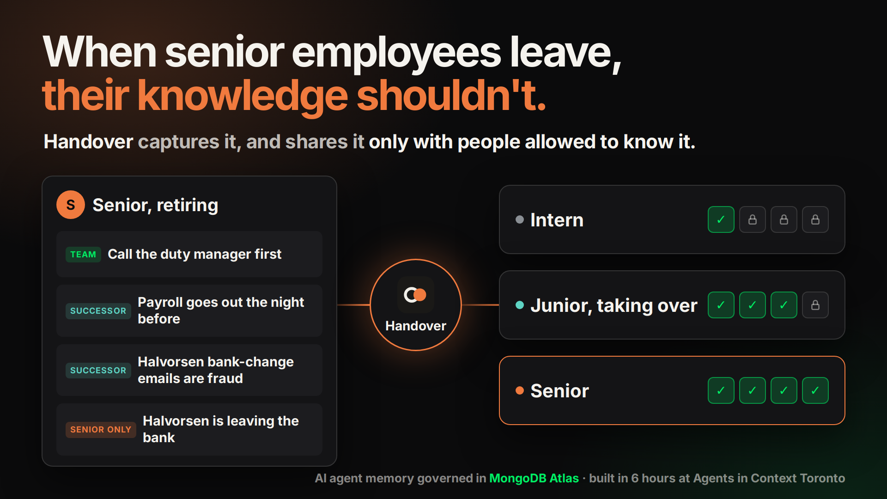

# Handover

**Governed memory for AI agents, so a senior employee's knowledge outlives their last day.**

Built in six hours at **Agents in Context Toronto**, a MongoDB hackathon organized by Cerebral Valley (November 14, 2026), for the **Memory You Can Govern** problem statement.

[](docs/media/handover_demo.mp4)

**[Watch the 70-second demo](docs/media/handover_demo.mp4)** (click the image or this link).

---

## The problem

When senior employees leave, the process knowledge they built up over years usually leaves with them, because most of it was never written down: which deadline thousands of paycheques depend on, which screen quietly adds extra zeros to a payment, which client only approves transfers by phone.

An AI agent can capture that knowledge. But then the agent knows things not everyone should hear, and someone has to decide who gets to see what. Most enterprise AI tools control access to documents that already exist. The memories an agent creates from a conversation have no file and no permissions of their own.

**Handover governs what the agent learns.**

## How it works

1. **Exit interview.** A voice agent interviews the person who is leaving. ElevenLabs transcribes, Gemini extracts procedures, systems, clients and workarounds, and the agent follows up when two answers contradict each other.
2. **Every memory is born with governance metadata.** Each one is stored in MongoDB Atlas with an owner, an access scope, an expiry and a link to the recording it came from. `$jsonSchema` validation rejects any memory missing them.
3. **Access is enforced in the database, not the prompt.** When someone asks a question, their role becomes a pre-filter inside the `$vectorSearch` query. Memories they can't read are never retrieved, so they never reach the model and no prompt can pull them out.
4. **The same rule holds everywhere the knowledge shows up**, from checklists built on top of memories to live updates and expiry (details below).
5. **Every answer is traceable.** LangSmith records who asked, which scopes they were allowed, and which memory ids the agent used.

### Who sees what

The demo is a bank's payments team. All names and data are fictional.

| Person | Can read | Example: "I'm taking over the Halvorsen Freight account. What should I know?" |
|---|---|---|
| **Intern** | `team` memories | Nothing. Two memories exist but are withheld, and the withheld read is logged. |
| **Junior, taking over** | `successor` + `team` | The fraud warning: Halvorsen only approves transfers by phone, so an email asking to change their bank details is a scam. |
| **Senior, leaving** | everything, including `never_transfer` | The fraud warning, plus the confidential fact that Halvorsen is quietly moving to another bank. |

The model suggests a scope when it extracts a memory (client confidential → `never_transfer`, procedures → `successor`, general facts → `team`). The senior can re-scope, correct or forget any memory, and every change is audited.

## Engineering details

- **Derived knowledge inherits the strictest source.** A checklist step built from several memories only appears if the viewer can read all of them, so anything built from restricted knowledge stays restricted.
- **Forget means forget.** `$graphLookup` walks the memory's lineage, and the memory plus everything derived from it is removed in one multi-document transaction, with an audit entry.
- **Corrections are versioned.** A correction creates a new version that supersedes the old one, and steps derived from it are flagged for review.
- **Memories expire.** A TTL index removes memories about retired systems automatically, and expiry cascades like a forget.
- **Live views.** Change streams push every scope change, correction and forget to other users' screens over a WebSocket, redacted per viewer.
- **Hybrid retrieval.** `$rankFusion` combines `$vectorSearch` (Voyage AI embeddings) and Atlas Search, with the same scope filter on both.
- **Resumable interviews.** The interview agent is a LangGraph graph whose state is checkpointed in Atlas with `MongoDBSaver`, so an interview survives a crash.
- **Voice rule.** Only the interviewer's voice is synthesized. Answers link back to the expert's original recording.

Full design, collections, indexes and pipelines: [backend/ARCHITECTURE.md](backend/ARCHITECTURE.md).

## Stack

MongoDB Atlas (Vector Search, Atlas Search, `$rankFusion`, `$jsonSchema`, TTL indexes, change streams, `$graphLookup`, transactions) · LangGraph with the MongoDB checkpointer · LangSmith · Voyage AI · ElevenLabs · Gemini · FastAPI (Python) · Next.js

## Run it locally

You need Python 3.11 to 3.13, Node 20+, a MongoDB Atlas cluster, and API keys for Voyage AI, Gemini, ElevenLabs and (optionally) LangSmith.

1. Copy `.env.example` to `.env` at the repo root and fill it in. Use a database name of your own in `MONGODB_DB`; `seed.py` drops and recreates the collections in it.
2. Start the backend:
   ```bash
   cd backend
   python -m venv .venv
   source .venv/bin/activate        # Windows: .venv\Scripts\activate
   pip install -r requirements.txt
   python seed.py                   # loads the fictional demo data
   uvicorn main:app --port 8000
   ```
   Check it at `http://localhost:8000/health`, which should return `{"ok": true, "mongo": true}`.
3. Start the frontend in another terminal:
   ```bash
   cd frontend
   cp .env.example .env.local       # set NEXT_PUBLIC_USE_MOCKS=false and the same DEMO_PASSCODES
   npm install
   npm run dev
   ```
   Open `http://localhost:3000` and switch between the senior, junior and intern with the role menu in the top right.

## What's next

- Replace the demo logins with SSO, mapping identity-provider groups to scopes.
- Keep new memories private until the senior approves them. Today they become visible as soon as they're extracted, and the senior reviews afterward.
- An evaluation set per role that measures retrieval quality and leak rate. The scope filter controls what the agent retrieves; inferring a secret by combining facts a viewer is allowed to see is a harder, open problem.

## Team

Ayuub Hagi · Harsh Seetha · Keith Singh

All code in this repository was written during the hackathon. All demo data is fictional. Hackathon planning notes, the API contract and QA reports are in [docs/hackathon](docs/hackathon).
