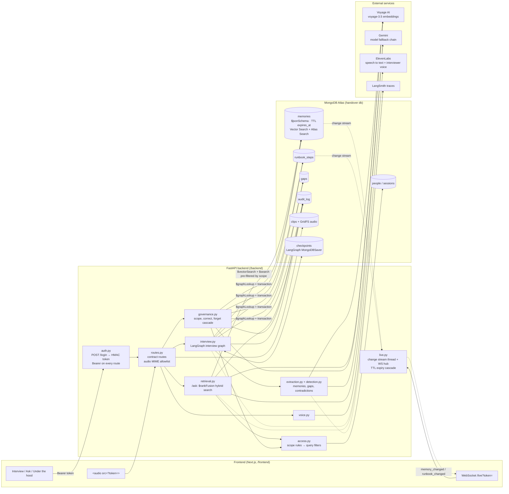
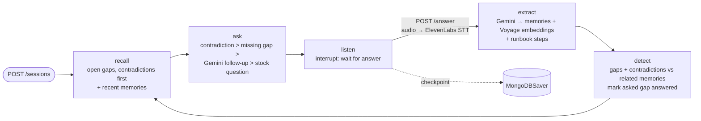
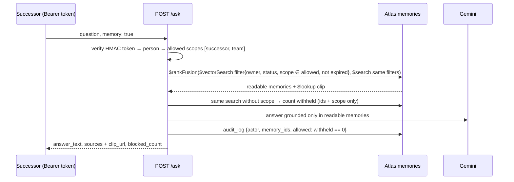
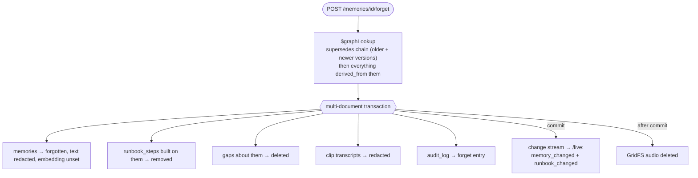

# Backend architecture

FastAPI + MongoDB Atlas. Run from `backend/`: `uvicorn main:app --reload`. Python 3.13, sync PyMongo everywhere
(FastAPI runs `def` endpoints in its threadpool; LangGraph `MongoDBSaver` is sync; change streams run in a thread).

## 0. Diagrams

### System



### Interview loop (LangGraph, state checkpointed in Atlas)



### Successor asks (leak prevention inside the query)



### Forget cascade (one transaction)



## 1. File layout and ownership

Flat modules, imported as `import db`, `import models`, etc.

| File | Owner | Purpose |
|---|---|---|
| `config.py` | db layer | `settings` loaded from `../.env` |
| `db.py` | db layer | client, collection handles, `ensure_schema()`, transactions, GridFS |
| `schemas.py` | db layer | `$jsonSchema` validators, regular/TTL/Search/Vector index definitions |
| `models.py` | db layer | ids, time, serializers (`memory_out` ...), doc builders, request bodies |
| `errors.py` | db layer | `NotFound`, `Forbidden`, `BadRequest` |
| `access.py` | db layer | who can read what: `allowed_scopes`, `readable_filter`, `can_govern` |
| `audit.py` | db layer | `write_audit` |
| `embeddings.py` | db layer | Voyage AI embeddings |
| `llm.py` | db layer | Gemini wrapper, LangSmith traced |
| `clips.py` | db layer | clip docs + audio bytes in GridFS |
| `seed.py` | db layer | fictional demo data |
| `retrieval.py` | retrieval+governance | hybrid search, `/ask` |
| `governance.py` | retrieval+governance | list, scope, correct, forget cascade, runbook, audit, gaps, lineage, expiry cascade |
| `interview.py` | agent loop | LangGraph graph + `MongoDBSaver`, `start_session`, `submit_answer` |
| `extraction.py` | agent loop | transcript -> memories |
| `detection.py` | agent loop | gaps and contradictions |
| `voice.py` | voice+API | ElevenLabs speech to text and interviewer text to speech |
| `live.py` | voice+API | change stream thread -> websocket hub + cascade worker |
| `routes.py` | voice+API | every route in the TEAM.md contract |
| `main.py` | voice+API | app, lifespan, CORS, error handlers |
| `tests/test_contract.py` | integration | end to end contract test |

## 2. Collections

Ids are strings: `m_`, `c_`, `s_`, `r_`, `g_`, `a_` + 8 hex chars (`models.new_id`). Stored as `_id`, returned as `id`.
All validators are `validationLevel: strict`, `validationAction: error`. Full definitions live in `schemas.py`.

- **people** `{_id, name, role: expert|successor|outsider, team, successor_of: str|null}`
- **clips** `{_id, owner_id, speaker: expert|interviewer, audio_url, transcript, session_id, audio_file_id: ObjectId|null, content_type, created_at}`
- **memories** required: `owner_id, kind, text, scope, status, version, source_clip_id, session_id, created_at, expires_at`.
  `kind: procedure|system|client|workaround`, `scope: successor|team|never_transfer`, `status: active|corrected|forgotten`,
  `version: int>=1`, `supersedes: str|null`, `derived_from: [str]`, `embedding: [double]` (absent once forgotten), `created_at/expires_at: date`.
  Change stream pre and post images are enabled so TTL deletes still carry the document.
- **runbook_steps** `{_id, text, derived_from: [memory id], status: active|needs_review|removed, order, created_at, updated_at}`
- **gaps** `{_id, owner_id, question, kind: missing|contradiction, from_memory_ids, status: open|asked|answered, session_id, created_at}`
- **audit_log** `{_id, actor_id, action, memory_ids, allowed, reason, ts, detail?}`
  actions: `ask, list_memories, set_scope, correct, forget, expire, interview_recall, read_runbook`
- **sessions** `{_id, expert_id, memory_on, status: active|closed, turn, created_at}` (graph state itself lives in the checkpointer)
- **checkpoints / checkpoint_writes**: LangGraph `MongoDBSaver`, same database.
- **clip_audio.files / .chunks**: GridFS bucket for audio.

## 3. Indexes

| Collection | Index | Notes |
|---|---|---|
| memories | Vector Search `memories_vector` | `embedding` 1024 dims cosine; filter fields `owner_id, scope, status, expires_at` |
| memories | Atlas Search `memories_text` | `text` string (lucene.standard); `owner_id, scope, status, kind` token; `expires_at` date |
| memories | TTL `expires_at_ttl` | `{expires_at: 1}`, `expireAfterSeconds: 0` |
| memories | `{owner_id:1,status:1,scope:1}`, `{derived_from:1}`, `{supersedes:1}`, `{session_id:1}` | |
| runbook_steps | `{derived_from:1}`, `{status:1,order:1}` | |
| gaps | `{owner_id:1,status:1}` | |
| audit_log | `{ts:-1}`, `{actor_id:1,ts:-1}` | |
| clips | `{session_id:1}` | |

## 4. Access rules (`access.py`)

`allowed_scopes(viewer, owner_id)`:
- viewer is the owner: `successor, team, never_transfer`
- viewer.successor_of == owner: `successor, team`
- viewer.team == owner's team: `team`
- anyone else (Riley): `[]`

`readable_filter(viewer, owner_id, now)` = `{owner_id, status: "active", scope: {$in: allowed}, expires_at: {$gt: now}}`.
This exact filter goes into `$vectorSearch.filter`; the Atlas Search side builds the same thing with `compound.filter`.
Only the owner can set scope, correct, or forget. Missing, forged or expired token -> 401.

## 5. Endpoints and pipelines

Every endpoint except `/login` and `/health` resolves `viewer = auth.person_from_token(Bearer token)`. `POST /login {user_id, passcode}` checks `DEMO_PASSCODES` and returns `base64url({sub, exp}).base64url(HMAC-SHA256(AUTH_SECRET))`. A client-asserted user id is never trusted.

### POST /ask (`retrieval.ask`)
Owner = `access.default_expert_id()`. `memory: false` -> no retrieval, LLM answers with no context, `sources: []`, audited.

```js
[
  { $rankFusion: {
      input: { pipelines: {
        vector: [ { $vectorSearch: { index: "memories_vector", path: "embedding", queryVector: qv,
                    numCandidates: 100, limit: 10, filter: readable_filter } } ],
        text:   [ { $search: { index: "memories_text", compound: {
                      must:   [ { text: { query: question, path: "text" } } ],
                      filter: [ { equals: { path: "owner_id", value: owner } },
                                { equals: { path: "status", value: "active" } },
                                { in:     { path: "scope", value: allowed } },
                                { range:  { path: "expires_at", gt: now } } ] } } },
                  { $limit: 10 } ] } },
      combination: { weights: { vector: 0.6, text: 0.4 } },
      scoreDetails: true } },
  { $addFields: { _score: { $meta: "scoreDetails" } } },
  { $limit: k },
  { $lookup: { from: "clips", localField: "source_clip_id", foreignField: "_id", as: "clip" } },
  { $project: { embedding: 0 } }
]
```
If `allowed` is empty the query is skipped (nothing can match). If the cluster rejects `$rankFusion`, fall back to the
same two sub-pipelines joined with `$unionWith` and reciprocal rank fusion in `$group` (same filters).

`blocked_count`: same pipeline with the scope clause removed, projecting only `_id` and `scope`, counting hits the viewer
cannot read. No text leaves the database for those. Audit: `action: "ask"`, `memory_ids` = source ids,
`allowed = len(sources) > 0 or blocked_count == 0`, reason names the scopes and the blocked count.
The whole call is `@traceable(name="ask")` with `used_memory_ids` in the run metadata/outputs.

### GET /memories?owner_id=
Owner: `find({owner_id})` all statuses, newest first. Others: `find(readable_filter)`. Never returns `embedding`. Audited.

### PATCH /memories/{id}/scope
Owner only. `find_one_and_update({_id, status: "active"}, {$set: {scope}})` + audit, in a transaction.
The change stream pushes `memory_changed` and `runbook_changed`.

### POST /memories/{id}/correct
Owner only, memory must be `active`. Embed new text first, then one transaction:
1. old: `status -> corrected`
2. insert new: `version + 1`, `supersedes: old._id`, same owner/kind/scope/clip/session/expires
3. `memories.update_many({derived_from: old}, [$set derived_from: $map swap old->new])`
4. `runbook_steps.update_many({derived_from: old, status: {$ne: "removed"}}, [swap, status: "needs_review"])`
5. audit `correct`

### POST /memories/{id}/forget (the cascade)
Owner only. One aggregation finds the blast radius:

```js
[
  { $match: { _id: id } },
  { $graphLookup: { from: "memories", startWith: "$supersedes", connectFromField: "supersedes",
                    connectToField: "_id", as: "older_versions" } },
  { $graphLookup: { from: "memories", startWith: "$_id", connectFromField: "_id",
                    connectToField: "supersedes", as: "newer_versions" } },
  { $addFields: { chain_ids: { $setUnion: [["$_id"], "$older_versions._id", "$newer_versions._id"] } } },
  { $graphLookup: { from: "memories", startWith: "$chain_ids", connectFromField: "_id",
                    connectToField: "derived_from", as: "descendants" } },
  { $addFields: { all_ids: { $setUnion: ["$chain_ids", "$descendants._id"] } } },
  { $lookup: { from: "runbook_steps", let: { ids: "$all_ids" },
               pipeline: [ { $match: { $expr: { $and: [
                   { $ne: ["$status", "removed"] },
                   { $gt: [ { $size: { $setIntersection: ["$derived_from", "$$ids"] } }, 0 ] } ] } } } ],
               as: "steps" } },
  { $project: { all_ids: 1, step_ids: "$steps._id" } }
]
```
Then one multi-document transaction (`db.run_in_transaction`):
1. `memories.update_many({_id: {$in: all_ids}}, {$set: {status: "forgotten", text: "[forgotten]"}, $unset: {embedding: ""}})`
2. `runbook_steps.update_many({_id: {$in: step_ids}}, {$set: {status: "removed", text: "[removed]"}})`
3. `gaps.delete_many({from_memory_ids: {$in: all_ids}})`
4. `clips.update_many` for clips whose every memory is now forgotten: `transcript: "[forgotten]"`
5. `audit_log.insert_one` `forget`

After commit, delete the GridFS audio of those clips. Returns `{forgotten_ids, runbook_steps_removed, audit_id}`.

`governance.lineage(id)` answers "why does the agent know this" with the upward `$graphLookup`
(`connectFromField: "derived_from"`, `connectToField: "_id"`) plus the `supersedes` chain. Internal, used in traces.

### GET /runbook
A step is visible only if every source memory is readable by the viewer:
```js
[ { $match: { status: { $ne: "removed" } } },
  { $lookup: { from: "memories", let: { ids: "$derived_from" },
      pipeline: [ { $match: { $expr: { $in: ["$_id", "$$ids"] }, ...readable_filter } }, { $project: { _id: 1 } } ],
      as: "readable" } },
  { $match: { $expr: { $eq: [ { $size: "$readable" }, { $size: "$derived_from" } ] } } },
  { $sort: { order: 1 } } ]
```

### GET /audit?limit=20
Sorted `ts: -1`. Outsiders only see their own entries; expert and successor see all.

### GET /gaps?owner_id=
Owner only gets `find({owner_id})`; others get `[]` (gaps quote unreleased memories).

### POST /sessions, POST /sessions/{id}/answer
See section 7. Answer flow: save audio to GridFS as a clip -> ElevenLabs speech to text -> `interview.submit_answer`
-> ElevenLabs voice for the next question (stored as an `interviewer` clip, served by `/clips/{id}`).

### GET /clips/{clip_id}
Streams GridFS audio. Expert clips are only served if the viewer can read at least one active memory from that clip
(or owns it). Interviewer clips are served to anyone logged in. Browsers cannot set headers on `<audio>` or WebSockets, so
`?token=` is accepted for this route and for `/live`. Responses carry `X-Content-Type-Options: nosniff`, and uploads only accept audio/* types.

## 6. Change streams -> websocket (`live.py`)

One daemon thread runs `db.watch([{ $match: { "ns.coll": { $in: ["memories", "runbook_steps"] } } }],
full_document="updateLookup", full_document_before_change="whenAvailable")` with resume tokens.

- memories insert/update/replace -> broadcast `{type: "memory_changed", memory}`; also `{type: "runbook_changed"}`
  when `scope` or `status` changed (runbook visibility depends on them).
- memories delete (TTL expiry) -> cascade worker: `governance.cascade_expired(id, pre_image)` removes derived runbook
  steps and writes an `expire` audit entry; broadcast the pre-image as `status: "forgotten"`.
- runbook_steps any change -> `{type: "runbook_changed"}`.

Per connection redaction: if the viewer cannot read the memory (scope, status, or anonymous socket), the same Memory
shape is sent with `text: "[hidden]"`. The thread hands messages to the event loop with `asyncio.run_coroutine_threadsafe`.

## 7. Interview agent (`interview.py`)

`StateGraph` compiled with `MongoDBSaver(db.get_client(), db_name=settings.MONGODB_DB)`, `thread_id = session_id`.

```
START -> recall -> ask -> listen -(interrupt)-> extract -> detect -> recall -> ask -> listen ...
```
- `recall`: (memory on) load open gaps for the expert, contradictions first, plus recent memory texts. Audit `interview_recall`.
- `ask`: pick the next question: open contradiction gap > open missing gap > LLM follow up from recent memories > stock question.
  Marks the gap `asked`, sets `current_gap_id`, `used_memory_ids = gap.from_memory_ids`.
- `listen`: `interrupt({"question": ...})`. The checkpoint sits in Atlas until `/answer` resumes with
  `Command(resume={"transcript", "clip_id"})`. A server restart loses nothing.
- `extract`: `extraction.extract_memories` -> embed -> insert memories (client kind defaults to `never_transfer`),
  add a runbook step for each procedure/workaround.
- `detect`: `detection.detect_gaps` compares new memories with `retrieval.related_memories` and inserts gaps;
  marks `current_gap_id` answered.

State: `session_id, expert_id, memory_on, turn, question, current_gap_id, used_memory_ids, transcript, clip_id,
new_memory_ids, new_gap_ids, history: [{q, a}]`. LangSmith traces come from `LANGSMITH_TRACING=true`; LLM calls are `@traceable`.

## 8. Function signatures between modules

```python
# config.py
settings.MONGODB_URI, MONGODB_DB, VOYAGE_API_KEY, VOYAGE_MODEL, EMBED_DIMS, GOOGLE_API_KEY, GEMINI_MODEL,
ELEVENLABS_API_KEY, ELEVENLABS_VOICE_ID, ELEVENLABS_TTS_MODEL, ELEVENLABS_STT_MODEL, PUBLIC_BASE_URL,
MEMORY_TTL_DAYS, CORS_ORIGINS

# db.py
get_client() -> MongoClient;  get_db() -> Database;  col(name) -> Collection
PEOPLE, CLIPS, MEMORIES, RUNBOOK, GAPS, AUDIT, SESSIONS   # collection name constants
VECTOR_INDEX = "memories_vector";  TEXT_INDEX = "memories_text"
ensure_schema(wait_for_search: bool = False) -> None
run_in_transaction(fn: Callable[[ClientSession], T]) -> T
audio_bucket() -> gridfs.GridFSBucket

# models.py
new_id(prefix) -> str;  utcnow() -> datetime;  iso(dt) -> str
memory_out(doc) -> dict;  gap_out(doc) -> dict;  runbook_out(doc) -> dict;  audit_out(doc) -> dict
hidden_memory(mem_out) -> dict;  clip_url(clip_id) -> str
build_memory_doc(*, owner_id, kind, text, embedding, scope, source_clip_id, session_id,
                 expires_at=None, derived_from=None, supersedes=None, version=1, memory_id=None) -> dict
SessionCreate, ScopeBody, CorrectBody, AskBody      # pydantic

# errors.py
NotFound, Forbidden, BadRequest, Unauthorized      # all subclass HandoverError(status_code, detail)

# access.py
get_person(user_id) -> dict | None;  require_person(user_id) -> dict
default_expert_id() -> str
allowed_scopes(viewer, owner_id) -> list[str]
readable_filter(viewer, owner_id, now=None) -> dict
can_read(viewer, memory_doc, now=None) -> bool;  can_govern(viewer, memory_doc) -> bool

# audit.py
write_audit(actor_id, action, memory_ids, allowed, reason, *, session=None, detail=None) -> str

# embeddings.py
embed_documents(texts: list[str]) -> list[list[float]];  embed_query(text) -> list[float]

# llm.py
llm_available() -> bool
generate_text(prompt, *, system=None, temperature=0.2) -> str
generate_json(prompt, schema: type[BaseModel], *, system=None, temperature=0.1) -> BaseModel

# clips.py
save_clip(*, owner_id, session_id, transcript, audio: bytes | None, content_type="audio/mpeg",
          speaker="expert", clip_id=None) -> dict
set_transcript(clip_id, transcript) -> None
get_clip(clip_id) -> dict | None
read_audio(clip_doc) -> tuple[bytes, str] | None
delete_audio(clip_doc) -> None

# retrieval.py
hybrid_search(question, *, owner_id, scopes: list[str], k=5, query_vector=None) -> list[dict]   # docs + clip + _score
related_memories(text, owner_id, *, k=5, exclude_ids=()) -> list[dict]     # owner level, for the agent
ask(viewer, question, memory_on=True) -> dict                               # contract response

# governance.py
list_memories(viewer, owner_id) -> list[dict];  set_scope(viewer, memory_id, scope) -> dict
correct_memory(viewer, memory_id, text) -> dict;  forget_memory(viewer, memory_id) -> dict
cascade_expired(memory_id, pre_image=None) -> list[str]
list_runbook(viewer) -> list[dict];  list_audit(viewer, limit=20) -> list[dict];  list_gaps(viewer, owner_id) -> list[dict]
lineage(memory_id) -> dict

# extraction.py / detection.py
extract_memories(transcript, *, context: list[str] = ()) -> list[dict]     # {kind, text, scope, expires_in_days}
detect_gaps(new_memories: list[dict], related: list[dict], transcript: str) -> list[dict]  # {question, kind, from_memory_ids}

# interview.py
start_session(expert_id, memory_on=True) -> dict   # {session_id, first_question_text, used_memory_ids}
submit_answer(session_id, transcript, clip_id) -> dict
    # {memories_created: [Memory], gaps_created: [Gap], next_question_text, used_memory_ids}

# voice.py
transcribe(audio: bytes, filename="answer.webm", content_type="audio/webm") -> str
synthesize(text) -> bytes | None
speak(text, session_id) -> str | None      # tts -> interviewer clip -> absolute url

# live.py
hub.start(loop) / hub.stop();  async hub.connect(ws, viewer | None);  hub.disconnect(ws)
```

## 9. Degraded modes (so the demo never hard fails)

- No `VOYAGE_API_KEY`: deterministic hashed embeddings (dev only, logged loudly).
- No `GOOGLE_API_KEY`: `/ask` answers by quoting the top source; extraction and detection use keyword heuristics.
- No `ELEVENLABS_API_KEY`: audio urls are `null`; `/answer` accepts an optional `transcript` form field instead of speech to text.
- Search indexes not ready or `$rankFusion` unsupported: manual reciprocal rank fusion, then filtered `find` as a last resort.
